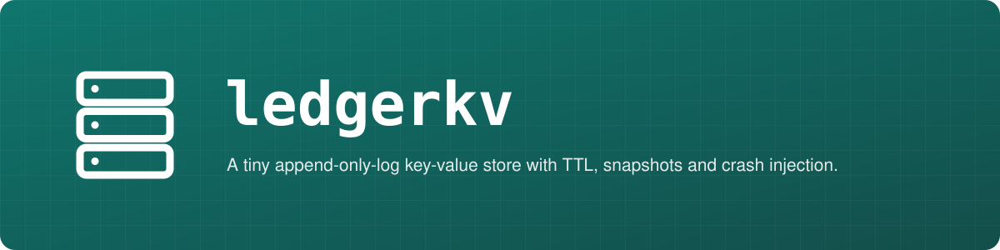
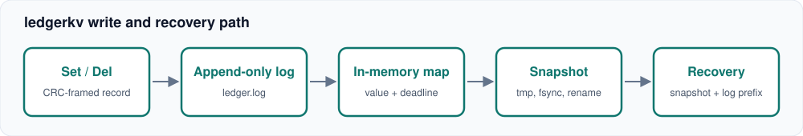

<p align="center"></p>

# ledgerkv

> A tiny append-only-log key-value store with TTL, snapshots and crash injection.

[](https://github.com/AbnormalityAI/ledgerkv/actions/workflows/ci.yml)

[](LICENSE)


`ledgerkv` is a small embeddable key-value store in Go. Every write is appended to a checksummed log, reads are served from memory, and a snapshot compacts the log. The point of the project is the test suite: it simulates a torn write at **every byte offset** of a 40-operation log and a failure at each named step of a snapshot, then checks that recovery lands on a state a client could have observed. These are in-process simulations, not real process kills or power-loss tests.

Inspired by the "small enough to read in one sitting" spirit of [tokio-rs/mini-redis](https://github.com/tokio-rs/mini-redis). It is not a Redis clone and speaks no network protocol. It is written in Go rather than Rust as a deliberate toolchain choice.

## Features

- Append-only log with a CRC32 and length header on every record
- Per-key TTL stored as an absolute deadline, so expiry survives restarts
- Snapshot compaction: write temp file, fsync, atomic rename, truncate log
- Torn-tail recovery: replay stops at the first bad record and truncates it away
- Deterministic fault injection (`CrashAfterBytes` torn writes, snapshot `Hook`) with an injectable clock
- Fails closed: a failed write or fsync closes the store for writes; records too large to read back (over 64 MiB) are rejected with `ErrTooLarge` at write time
- Replay only truncates on genuine data damage (torn tail or bad checksum), never on an I/O error
- Zero dependencies, one small CLI and REPL

## Quickstart

```sh
# from a checkout
git clone https://github.com/AbnormalityAI/ledgerkv && cd ledgerkv
go build -o ledgerkv ./cmd/ledgerkv
# or, once published: go install github.com/AbnormalityAI/ledgerkv/cmd/ledgerkv@latest

./ledgerkv -dir ./data set session abc123 30s
./ledgerkv -dir ./data get session
./ledgerkv -dir ./data ttl session
./ledgerkv -dir ./data snapshot
printf 'set a 1\nget a\nlen\n' | ./ledgerkv -dir ./data repl
```

As a library:

```go
s, _ := ledgerkv.Open("data", ledgerkv.Options{SyncEveryWrite: true})
defer s.Close()
s.Set("k", []byte("v"), time.Minute)
v, ok := s.Get("k")
```

## Architecture



Record layout: `crc32(payload) | len(payload) | op | keylen | key | expireAt | value`, big-endian.

- **Write path:** encode, append to the log, then update the map. If the append fails, the map is untouched.
- **Recovery:** load `ledger.snap` if present, replay `ledger.log` until the first torn or corrupt record, truncate the log to the last good boundary.
- **Snapshot:** every live entry goes to `ledger.snap.tmp`, which is fsynced and renamed over `ledger.snap`; the directory is fsynced so the rename is durable, and only then is the log truncated. Replaying the old log over the new snapshot is idempotent, so a crash between rename and truncate is safe. A leftover tmp file is discarded on open.
- **Expiry:** lazy on read, dropped for good at snapshot time.

### Crash testing

| Test | What it proves |
|---|---|
| `TestCrashAtEveryByteOffset` | For each cut point from 1 byte to the full log of a 40-operation workload (a cut of 0 bytes is just the empty store), the recovered state equals the model after exactly the acknowledged writes |
| `TestCrashDuringSnapshot` | Crashing after the tmp write, after the rename, or after the truncate all recover the full state |
| `TestWriteErrorFailsClosed`, `TestIOErrorDuringReplayIsNotTornTail` | A failed write leaves the store closed for writes; a read error during replay fails `Open` instead of truncating |
| `TestOversizedWriteRejected`, `TestLargestAcceptedRecordSurvivesReopen` | Nothing is acknowledged that recovery would refuse to read |
| `TestBitFlipStopsReplayAtDamage` | A flipped bit drops that record and everything after it, never earlier data |

## Known limitations

- Values live in memory, so the dataset must fit in RAM.
- Single process only, no file locking. Do not open one directory twice.
- A bit flip mid-log discards the rest of the log by design (stop at first damage).
- Durability across real power loss is not tested; fsync behaviour depends on the filesystem and hardware. The snapshot rename is made durable (directory fsync, best effort on platforms that cannot sync directories) before the log is truncated.
- After `Close` or a failure, `Get`, `TTL` and `Len` keep serving the in-memory state while writes and snapshots return `ErrClosed`.
- A single record (key plus value plus a 21-byte header) is capped at 64 MiB.

## Roadmap

- [ ] Group commit for concurrent writers
- [ ] Log rotation by size with automatic snapshots
- [ ] Optional TCP front end speaking a small subset of RESP
- [ ] Fuzz target for the record decoder

## License

MIT, see [LICENSE](LICENSE).
